# Task Management App

A simple and modern Task Management mobile application built using Flutter and Dart.

The application helps users organize their daily tasks, view task statistics, and add new tasks through a clean and responsive user interface.

---

## 📱 About The App

The Task Management App allows users to create their profile and manage their daily tasks.

The application includes a simple dashboard where users can:

- View their profile
- View task statistics
- View today's tasks
- Check task status
- Add new tasks
- Choose task status
- Choose task color
- Switch between English and Arabic

---

## ✨ Features

- 👤 Create Profile
- 🏠 Home Dashboard
- 📋 Today's Tasks
- ➕ Add New Task
- 📝 Task Title
- 📄 Task Description
- 🔄 Task Status
- 🎨 Task Color Selection
- 📊 Task Statistics
- 🌐 English & Arabic Languages
- 📱 Responsive UI
- 🎨 Clean and Modern Design

---

## 🛠️ Technologies Used

- Flutter
- Dart
- Flutter ScreenUtil
- Easy Localization

---

## 📦 Packages

The main packages used in this project are:

```yaml
dependencies:
  flutter:
    sdk: flutter

  cupertino_icons: ^1.0.8
  flutter_screenutil: ^5.9.3
  easy_localization: ^3.0.8
  image_picker: ^1.1.2
  hive: ^2.2.3
  hive_flutter: ^1.1.0
  hive_generator: ^2.0.1
  build_runner: ^2.5.4

```

---

# 📱 App Screens

## 1. Create Profile Screen

The Create Profile screen allows the user to enter their full name before entering the application.

### Screen Name

```text
create_profile.png
```

### Image Path

```text
assets/screenshots/create_profile.png
```


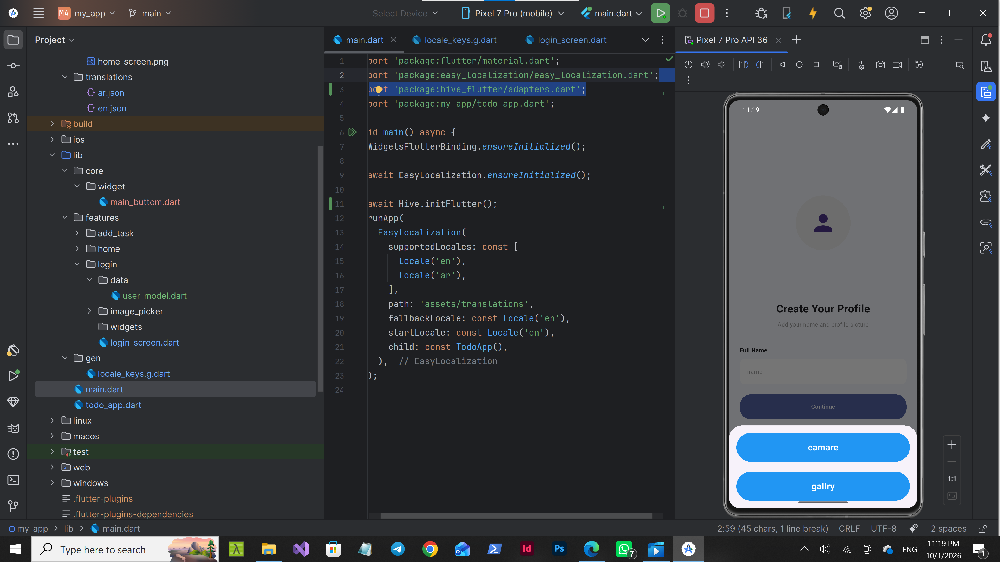
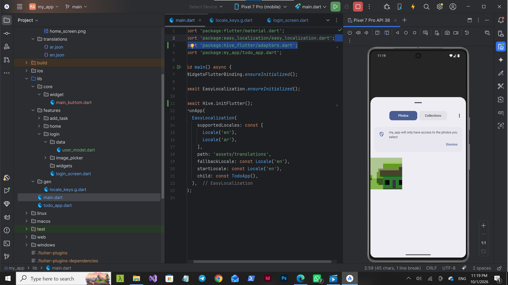
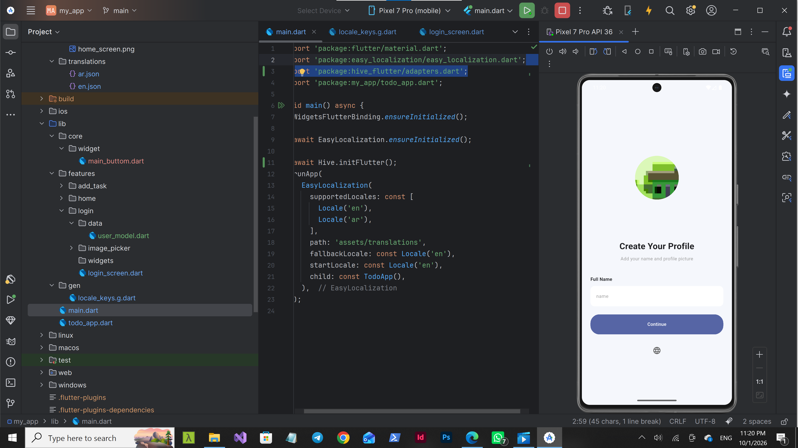


## 2. Home Screen

The Home screen displays the user's name, task statistics, and today's tasks.

The dashboard includes:

- Total Tasks
- Completed Tasks
- Pending Tasks
- Today's Tasks
- Task Status

### Screen Name

```text
home_screen.png
```

### Image Path

```text
assets/screenshots/home_screen.png
```

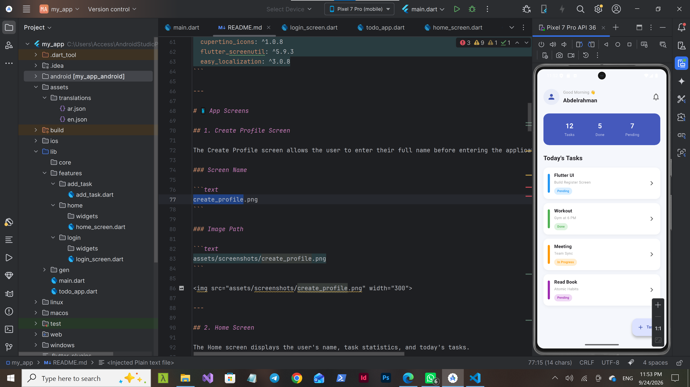
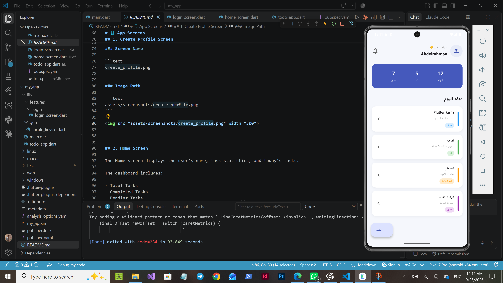

---

## 3. Add Task Screen

The Add Task screen allows users to create a new task.

Users can enter:

- Task Title
- Description
- Task Status
- Task Color

### Screen Name

```text
add_task.png
```

### Image Path

```text
assets/screenshots/add_task.png
```

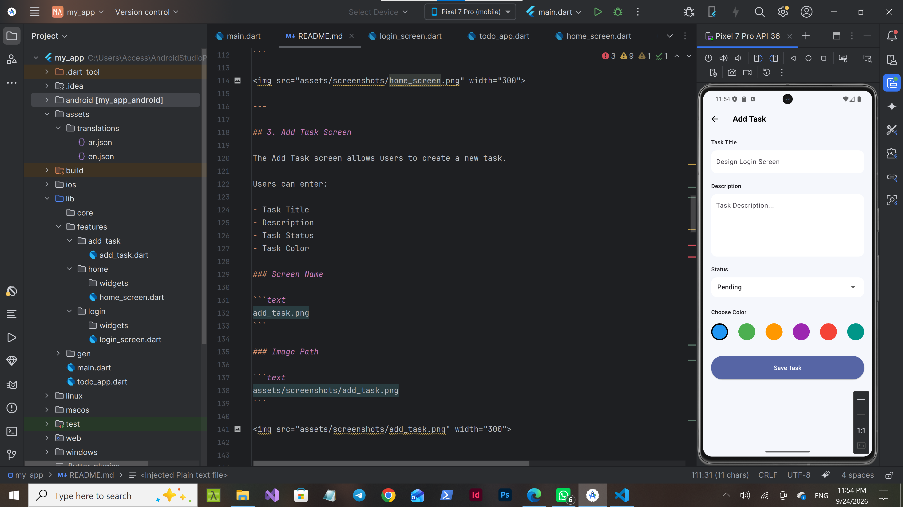
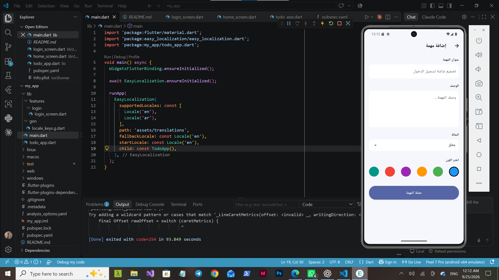
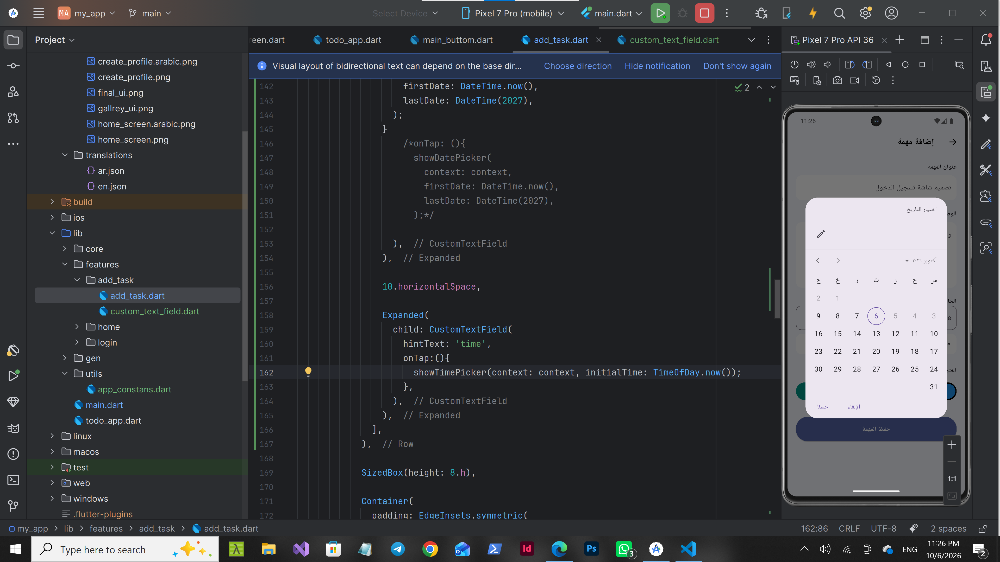
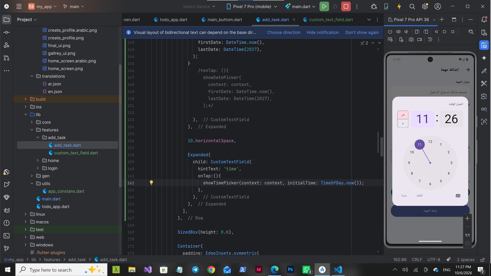
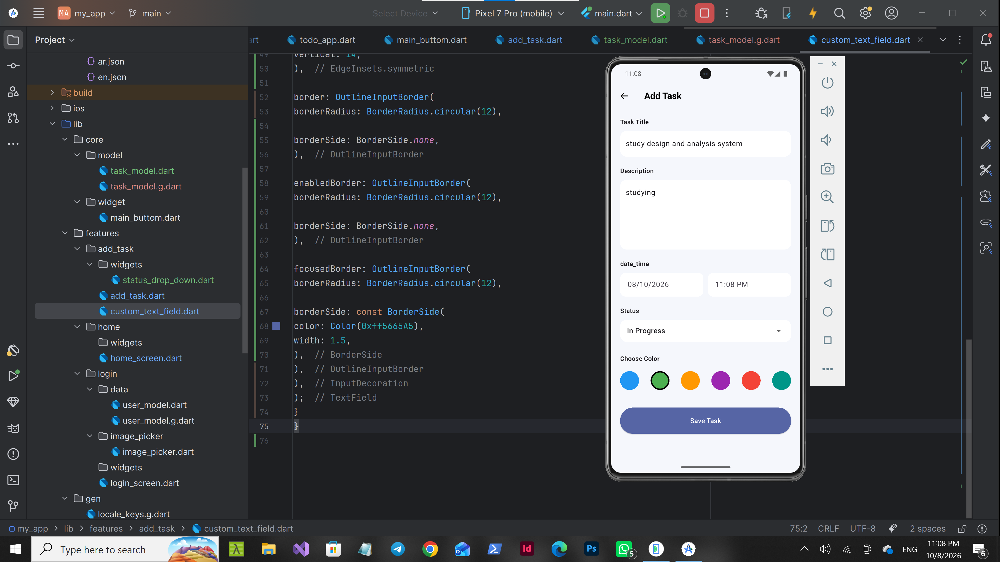
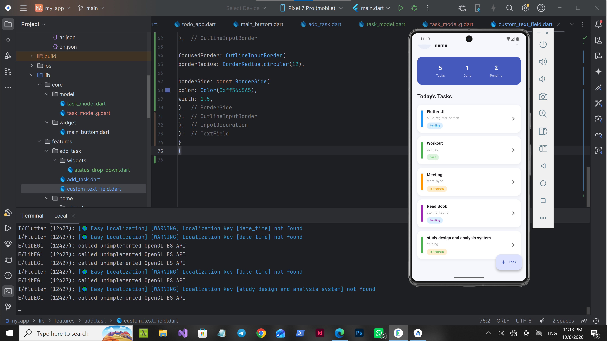

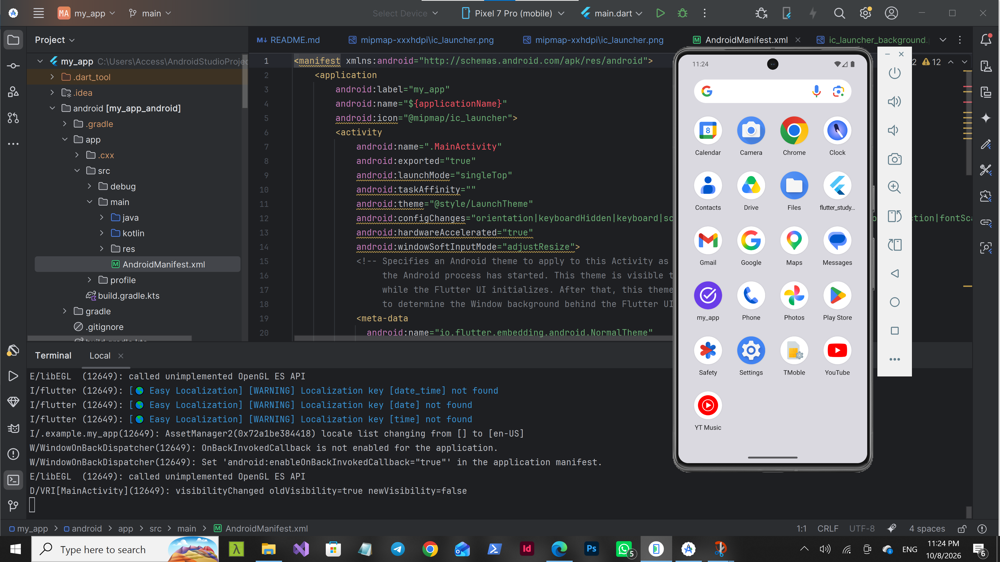

---

# 📐 Responsive Design

The application uses Flutter ScreenUtil to create a responsive user interface.

The application is designed to adapt to different mobile screen sizes.

The project uses:

```dart
ScreenUtilInit(
  designSize: const Size(420, 812),
  minTextAdapt: true,
  splitScreenMode: true,
)
```

Responsive units are used throughout the application:

```dart
20.w
20.h
18.sp
12.r
```

### Responsive Units

| Unit | Description |
|---|---|
| `.w` | Responsive width |
| `.h` | Responsive height |
| `.sp` | Responsive text size |
| `.r` | Responsive radius |

This helps the application maintain a consistent layout across different screen sizes.

---

# 🌍 Localization

The application supports two languages:

- 🇬🇧 English
- 🇪🇬 Arabic

Localization is implemented using:

```text
easy_localization
```

Translation files are stored in:

```text
assets/translations/
```

### English Translation

```text
assets/translations/en.json
```

### Arabic Translation

```text
assets/translations/ar.json
```

The user can switch between English and Arabic from the application.

---

# 📂 Project Structure

```text
my_app/
│
├── README.md
├── pubspec.yaml
│
├── lib/
│   │
│   ├── main.dart
│   ├── todo_app.dart
│   │
│   └── features/
│       │
│       ├── login/
│       │   └── login_screen.dart
│       │
│       ├── home/
│       │   └── widgets/
│       │       └── home_screen.dart
│       │
│       └── add_task/
│           └── add_task.dart
│
└── assets/
    │
    ├── translations/
    │   ├── ar.json
    │   └── en.json
    │
    └── screenshots/
        ├── create_profile.png
        ├── home_screen.png
        └── add_task.png


# 👨‍💻 Developer

Developed using Flutter and Dart.