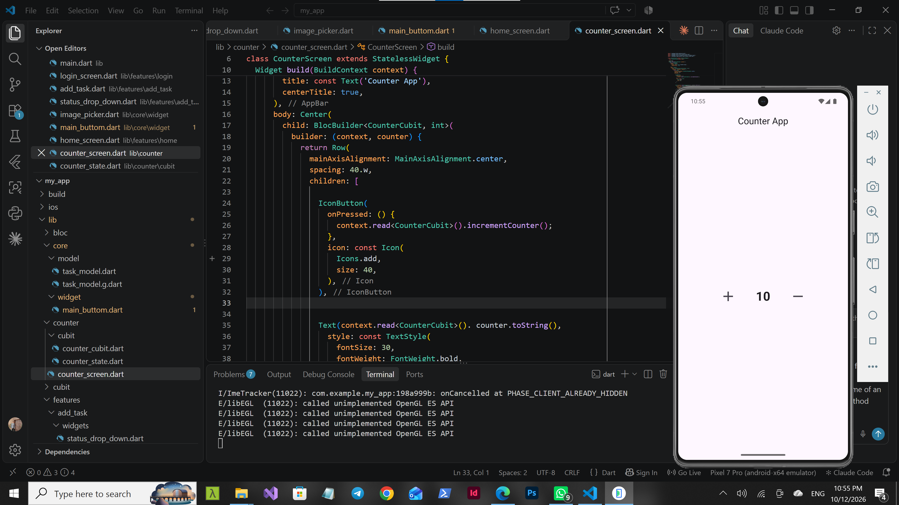
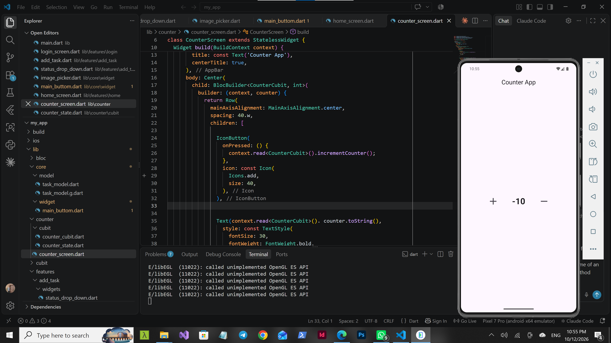

# Counter App using Flutter Bloc and Cubit

## 📌 Project Overview

The Counter App is a simple Flutter application that demonstrates state management using the `flutter_bloc` package and the Cubit pattern.

The application allows users to increment and decrement a counter by pressing the plus (+) and minus (-) buttons.

It also displays a message indicating whether the counter was incremented or decremented.

## 🎯 Project Objectives

* Understand state management in Flutter.
* Learn how to use Cubit.
* Understand the role of States.
* Learn how to provide a Cubit using BlocProvider.
* Use BlocBuilder to update the UI when the state changes.
* Separate application logic from the user interface.

## 🛠️ Technologies Used

* Flutter
* Dart
* flutter_bloc
* flutter_screenutil

## 📂 Project Structure

```text
lib/
├── counter/
│   └── cubit/
│       ├── counter_cubit.dart
│       └── counter_state.dart
│
├── counter_screen.dart
└── main.dart
```

## 1. Counter Screen

**File:** `counter_screen.dart`

The Counter Screen is responsible for displaying the application's user interface.

It contains:

* An AppBar displaying the title "Counter App".
* An increment button (+).
* A decrement button (-).
* A text widget displaying the current counter value.
* A message displaying the current operation.

### Main Responsibilities

* Display the counter value.
* Handle button presses.
* Call the appropriate Cubit methods.
* Listen to state changes using BlocBuilder.
* Rebuild the UI when a new state is emitted.

### Important Widget: BlocBuilder

`BlocBuilder<CounterCubit, CounterState>` listens to state changes and rebuilds the relevant part of the UI whenever the Cubit emits a new state.

This allows the application to display the latest operation without manually refreshing the screen.

## 2. Counter Cubit

**File:** `counter_cubit.dart`

CounterCubit contains the business logic of the counter application.

It extends `Cubit<CounterState>`, which means it manages and emits objects of type `CounterState`.

### Main Responsibilities

* Store the counter value.
* Increment the counter.
* Decrement the counter.
* Emit a new state after each operation.

### Increment Operation

When the user presses the plus (+) button, the `incrementCounter()` method increases the counter value by one and emits an `Increment` state.

### Decrement Operation

When the user presses the minus (-) button, the `decrementCounter()` method decreases the counter value by one and emits a `Decrement` state.

### What Is emit()?

The `emit()` method sends a new state from the Cubit.

When a new state is emitted, widgets listening to that Cubit can respond to the change and rebuild when appropriate.

## 3. Counter State

**File:** `counter_state.dart`

CounterState represents the different states of the counter application.

It defines the possible states that the CounterCubit can emit.

### CounterInitial

Represents the initial state when the application starts.

### Increment

Represents the state emitted when the user increments the counter.

### Decrement

Represents the state emitted when the user decrements the counter.

### Why Do We Need States?

States help the UI identify what happened in the application.

For example:

* `Increment` indicates that the increment operation occurred.
* `Decrement` indicates that the decrement operation occurred.

The UI can check the current state using type checks such as:

```dart
if (state is Increment) {
  // Display the increment message.
}

if (state is Decrement) {
  // Display the decrement message.
}
```

## 4. BlocProvider

**Widget:** `BlocProvider<CounterCubit>`

BlocProvider makes a Cubit available to widgets in a specific part of the widget tree.

It is commonly used to create and provide a Cubit to the screen that needs it.

### Example

```dart
BlocProvider(
  create: (context) => CounterCubit(),
  child: const CounterScreen(),
)
```

### How Does It Work?

1. BlocProvider creates an instance of CounterCubit.
2. CounterScreen can access the Cubit through the widget tree.
3. The buttons call Cubit methods using `context.read<CounterCubit>()`.
4. BlocBuilder listens to the Cubit's state changes.
5. The UI rebuilds when a new state is emitted.

### Why Is BlocProvider Important?

Without providing the Cubit to the appropriate widget tree, the screen cannot access that Cubit instance through `context.read<CounterCubit>()`.

BlocProvider helps manage the Cubit's lifecycle and makes it accessible to the widgets that depend on it.

## 5. BlocBuilder

BlocBuilder is used to rebuild a widget in response to state changes.

### Example

```dart
BlocBuilder<CounterCubit, CounterState>(
  builder: (context, state) {
    if (state is Increment) {
      return const Text('Increment');
    }

    if (state is Decrement) {
      return const Text('Decrement');
    }

    return const Text('Counter App');
  },
)
```




### BlocBuilder vs. context.read()

**BlocBuilder:**

* Listens for state changes.
* Rebuilds the UI when a new state is emitted.

**context.read():**

* Accesses the Cubit instance.
* Is useful for calling methods such as `incrementCounter()` and `decrementCounter()`.
* Does not subscribe the widget to state changes.

## 6. How the Application Works

The application follows these steps:

1. The application starts.
2. BlocProvider creates the CounterCubit.
3. CounterCubit starts with the `CounterInitial` state.
4. The user presses the plus or minus button.
5. The corresponding Cubit method executes.
6. The counter value changes.
7. Cubit emits an `Increment` or `Decrement` state.
8. BlocBuilder receives the state change.
9. The UI rebuilds to display the operation message and updated counter value.

## 7. Installation and Running

Make sure Flutter is installed on your computer.

### Step 1: Get Dependencies

Run the following command in the project directory:

```bash
flutter pub get
```

### Step 2: Run the Application

```bash
flutter run
```

## 8. Expected Results

* Pressing (+) increases the counter by one.
* Pressing (-) decreases the counter by one.
* The screen displays an increment message after an increment operation.
* The screen displays a decrement message after a decrement operation.
* The UI responds to state changes automatically.

## 9. Conclusion

This project demonstrates the fundamentals of state management in Flutter using Cubit.

It explains how CounterCubit manages application logic, CounterState represents application states, BlocProvider provides the Cubit to the widget tree, and BlocBuilder rebuilds the UI in response to state changes.

These concepts provide a foundation for building more structured and maintainable Flutter applications.

---

**Project:** Counter App

**Framework:** Flutter

**State Management:** Flutter Bloc / Cubit
